

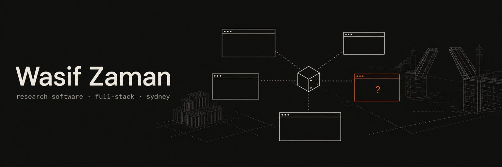

  

**Graduate software engineer in Sydney, Australia.** Research Software Engineer Intern at ACU, final-year Software Engineering (Honours) at Macquarie University. 
I build AI agent tooling, Python data and PDF reporting pipelines, Next.js and TypeScript web apps, 3D packing solvers, and embedded ESP32 control systems.


## Stack

    

     

     

     

## Featured work

### 01 · MetaTrooper
**The desk where you run all your coding agents at once.**

You run three agents in three terminals, lose track of which one is waiting on you, and paste screenshots back and forth. MetaTrooper runs **Claude Code, Codex and Gemini side by side**. Each gets a terminal that keeps going, and one wall shows **who needs you**. Local only: no account, no telemetry.

<table>
<tr>
<td width="50%" valign="top">

<b>The one that needs you comes to you.</b> When an agent asks a question, its pane moves to the big slot. Finished agents fold to one-line bars.
</td>
<td width="50%" valign="top">

<b>Answer without switching windows.</b> Pick an option or type a reply in the pane. The agent carries on.
</td>
</tr>
<tr>
<td width="50%" valign="top">

<b>Gates you approve in one place.</b> Pipelines stop before a PR, a deploy or a post. Only the window can approve, never an agent.
</td>
<td width="50%" valign="top">

<b>Ctrl+K for everything.</b> One search over agents, gates, commands and runs. No mouse needed.
</td>
</tr>
</table>

Agents can drive it too: a `troop` CLI and skill let Claude Code start a pipeline, wait on it, and hand a gate back to you instead of approving it.

  &nbsp; `TypeScript` `Electron` `Node.js` `node-pty` `Python` · Windows + Linux (beta)

 

### 02 · DynamicFit
**A 3D bin-packing solver for a warehouse client, with a browser visualiser.**

<a href="https://github.com/Wasif-ZA/dynamic-fit">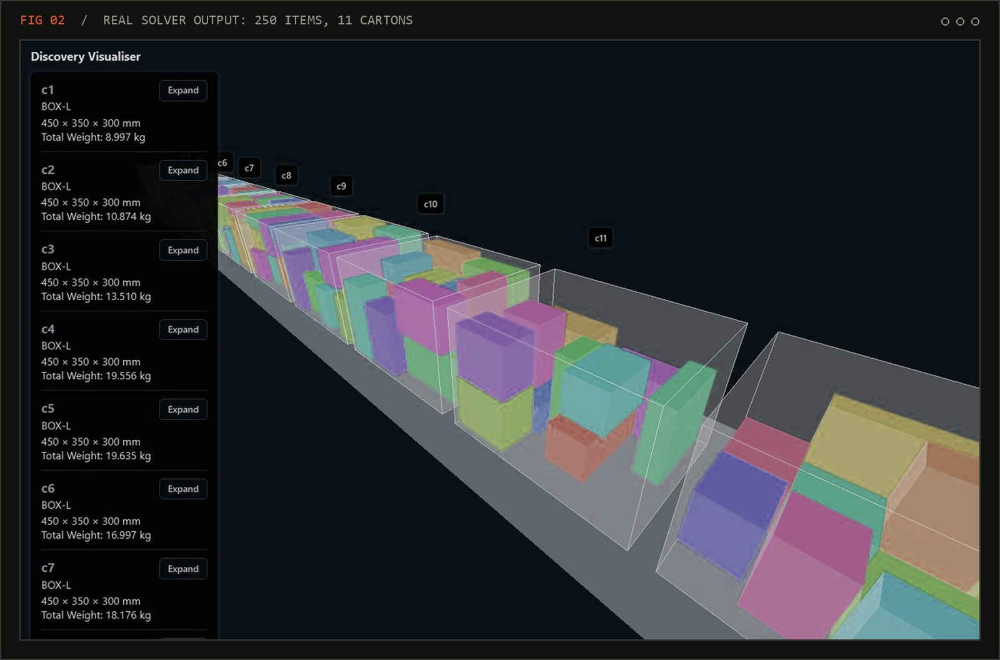</a>

Give it an order and the boxes a warehouse stocks. It picks **which boxes to use** and **where each item goes**, then draws the result in 3D. I designed the JSON Schema contract the other teams built against before the solver existed, and pinned it with render fixtures so one side can't silently break the other.


  &nbsp; `Python` `three.js` `JSON Schema` `Docker` · COMP4050 group project

 

### 03 · Korvo
**Type a company and a role. Get three researched contacts and a ready-to-send email for each.**

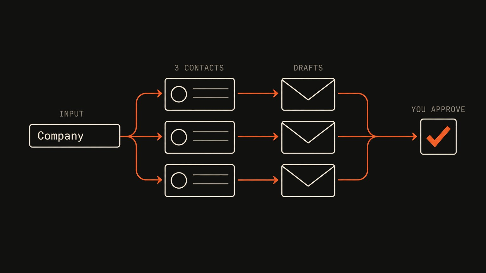


Four Claude agents run as a job graph. Every email waits for your approval, then sends from **your own Gmail**. Row-level security per user and Stripe billing. Clone it and run `npm run demo`: no API keys needed.

 &nbsp; `Next.js` `Claude API` `BullMQ` `Redis` `Stripe` `Supabase`

 

<table>
<tr>
<td width="50%" valign="top">

### 04 · Bridge Opening
**Capstone: a scale-model drawbridge built to fail safely.**

<a href="https://bridge-opening-project.vercel.app">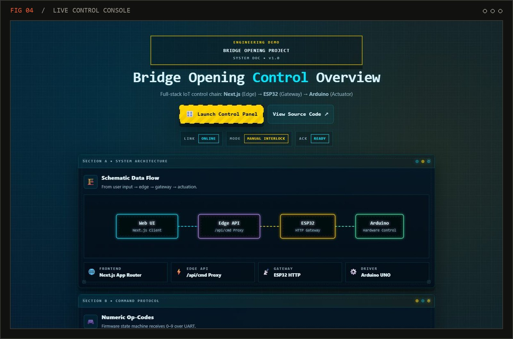</a>

Two microcontrollers run six sensors and four actuators in real time. If either board misses a heartbeat, the bridge stops.

**Safety layer:** collision detection, position limits, load sensing, emergency stop.

  
`C++` `ESP32` `Arduino` `Next.js`

</td>
<td width="50%" valign="top">

### 05 · BladeRunner
**A carriage that runs its route and stops before it hits anything.**

<a href="https://blade-runner-flax.vercel.app">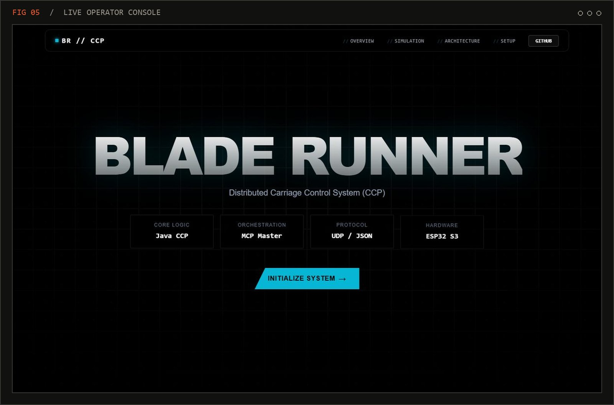</a>

A Java control program drives ESP32-S3 hardware over UDP and JSON. A master orchestrator coordinates it, and you run it from a Next.js console.

**Hard part:** telling a real obstacle from a noisy sensor reading.

  
`Java` `ESP32-S3` `UDP/JSON` `Next.js`

</td>
</tr>
<tr>
<td width="50%" valign="top">

### 06 · UTSBDSOC Platform
**Website and tooling for a ~300-member society.**

<a href="https://utbdsoc-website.vercel.app/home">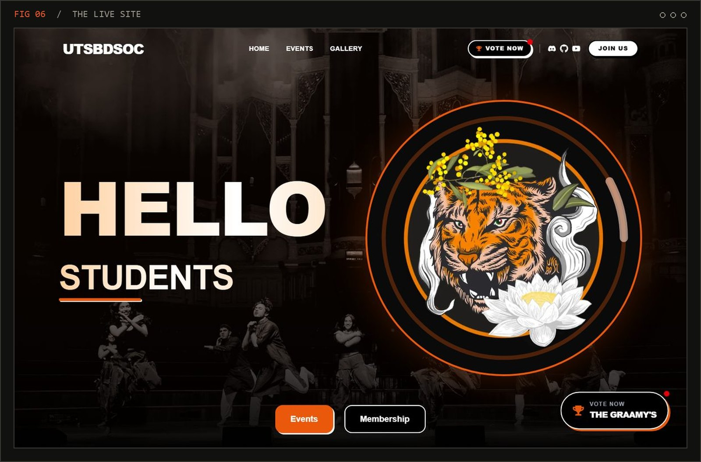</a>

None of the committee write code, so content comes from a headless CMS. Every change gets a preview deploy.

**The Graamys:** awards voting shipped in a two-week sprint. Nine categories, duplicate-vote prevention, and an audit trail.

  
`Next.js 16` `Supabase` `Prisma`

</td>
<td width="50%" valign="top">

### 07 · Report pipeline @ ACU
**My day job. Private repo.**

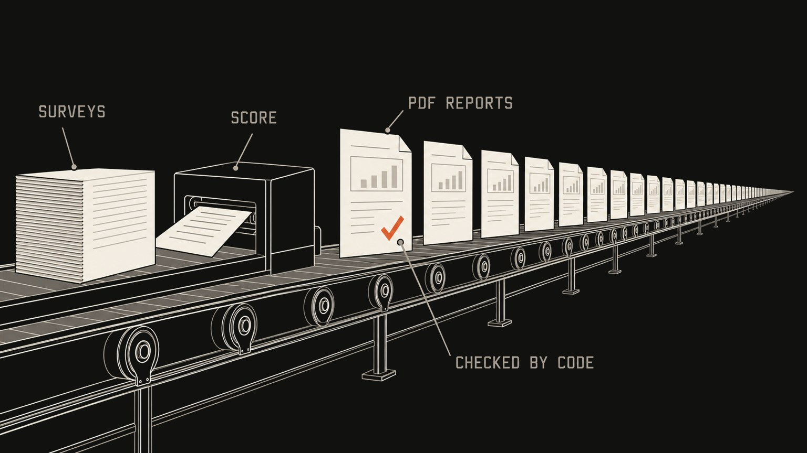

Thousands of PDFs render unattended, so a quiet scoring bug reaches a real person. Runs under an ethics protocol: no identifiable data on external services, and every change is peer reviewed.

`Python` `Azure Functions` `REDCap` `pandas`

</td>
</tr>
<tr>
<td width="50%" valign="top">

### 08 · Sprawll
**A research CLI that won't publish a claim it can't trace to a source.**

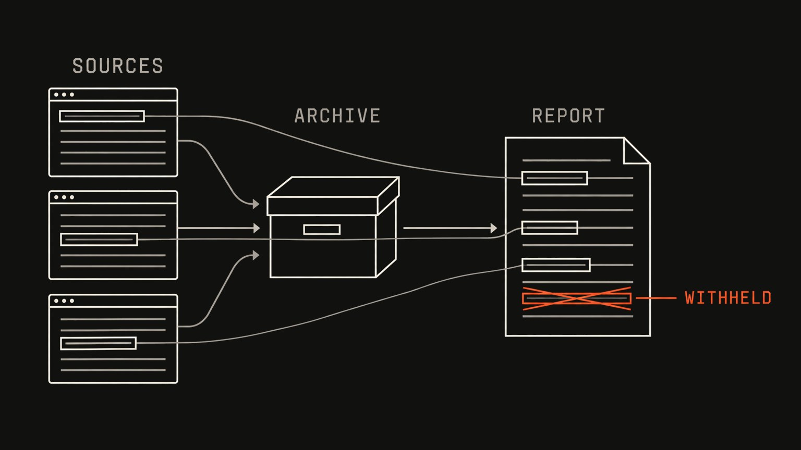

Claims that fail the check are **withheld and named**, never quietly left in.

 
`Python` `crawl4ai` `WARC`

</td>
<td width="50%" valign="top">

### 09 · aibō 相棒
**An assistant that knows who you are, so your tools stop asking.**

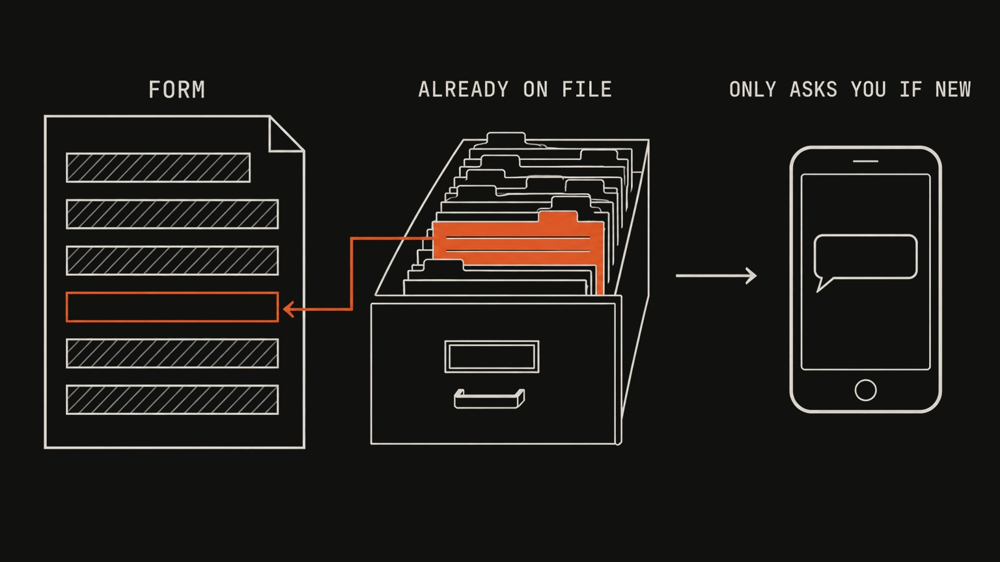

My job-hunting scripts applied to **zero jobs for six days**. Each form hit *"do you need visa sponsorship?"* and was thrown away. The answer was already in a config file. Nothing looked. aibō is the layer that looks.

| Command | What it does |
|:---|:---|
| `aibo brief` | What happened, what is stuck |
| `aibo doctor` | Health by outcome, not "the job ran" |
| `aibo asks` | Questions only you can answer |

 
`Python` `MCP`

</td>
</tr>
</table>

### Also on the bench

| Project | What it does | |
|:---|:---|:---|
| **AutoDocs** | Writes docs for a TypeScript codebase in CI. Model output is schema-checked and retried on failure |  |
| **claude-mods** | Mods for Claude Code. `session-deck` shows context, cost and what is waiting on you |  |
| **metarouter** | Tool memory for coding agents: reuses commands that worked, warns before ones that fail |  |
| **wasif-skills** | Claude Code skills: document verification and a spaced-repetition study loop |  |
| **decision.log** | Keeps the reasons behind architecture decisions after the people leave |  |
| **RFID Inventory Tracker** | Scanned tags update stock in real time. I was Scrum Master |  |
| **banjo** | Voice assistant that runs entirely on my own machine |  |

## Experience


| | Role | What I do |
|:---|:---|:---|
| **ACU IPPE** | Research Software Engineer Intern | Python service on Azure Functions that renders participant PDF reports. Mockups go in front of researchers before code |
| **Lenovo** | Desktop Rollout Engineer | Enterprise desktop rollouts on a Sydney CBD client site, scheduled so the business keeps running |
| **UTSBDSOC** | Technical Lead / IT Director | Own the site and tooling for ~300 members. Shipped the Graamys in two weeks |
| **Optus** | Sales Consultant | Matched plans and bundles to what each customer actually used |

**Macquarie University** · B.Eng (Honours) Software Engineering · Feb 2022 to Jun 2027 
Now: `COMP4050 Software Engineering Practices` `COMP4092 Research Thesis A` 
Certificates: Google Data Analytics · Meta Programming with JavaScript · IBM Intro to Cloud Computing

## Activity

<picture>
  <source media="(prefers-color-scheme: dark)" srcset="https://raw.githubusercontent.com/Wasif-ZA/Wasif-ZA/output/github-snake-dark.svg" />
  <source media="(prefers-color-scheme: light)" srcset="https://raw.githubusercontent.com/Wasif-ZA/Wasif-ZA/output/github-snake.svg" />
  
</picture>

  

 

